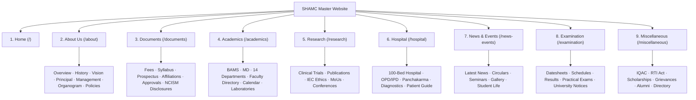

# COMPLETE INSTITUTIONAL WEBSITE SITEMAP & ROUTING ARCHITECTURE
**Institution:** Shri Haridutt Ayurvedic Medical College & Hospital  
**Affiliation:** Dr. S.R. Rajasthan Ayurved University, Jodhpur  
**Approval:** NCISM, Ministry of AYUSH, Govt. of India  
**Date:** November 5, 2026  

---

---

## DETAILED SITEMAP & URL STRUCTURE

### 1. HOME (`/`)
- `/` — Institutional Hero, Live Admissions Ticker, Principal's Welcome, Highlights, News, Hospital Overview, Downloads, Contact Directorate.

### 2. ABOUT US (`/about`)
- `/about` — Master Institutional Overview
- `/about/history` — Vedic Heritage, Legacy & Founding Vaidyas
- `/about/vision-mission` — Institutional Vision, Mission & Vedic Core Values
- `/about/management` — Academic Governing Council & Trust Management
- `/about/chairmans-message` — Message from the Chairman
- `/about/principals-message` — Message from the Principal & Medical Superintendent
- `/about/organization-structure` — College & Hospital Organizational Organogram
- `/about/administration` — Administrative Officers & Key Personnel
- `/about/committees` — Statutory Institutional Committees (ICC, Anti-Ragging, SGRC)
- `/about/annual-reports` — Institutional Annual Progress & Quality Reports
- `/about/policies` — Institutional Discipline, Gender Sensitization & Code of Conduct

### 3. DOCUMENTS (`/documents`)
- `/documents` — Master Document Vault & Category Repository
- `/documents/fee-structure` — Approved Academic Fee Schedule (BAMS / MD)
- `/documents/syllabus` — NCISM Prescribed Curriculum & Syllabi
- `/documents/admission-notifications` — Admission Guidelines, NEET Cutoffs & Circulars
- `/documents/recognition` — NCISM Recognition & AYUSH Govt. Letters
- `/documents/prospectus` — Official Information Brochure & Prospectus
- `/documents/college-info` — Institutional Factsheet & Basic Information
- `/mandatory-disclosures` — NCISM Mandatory Disclosures (16 Categories)
- `/documents/approvals` — University Affiliation (Dr. S.R. RAU) & SPCB/Fire NOCs
- `/documents/annual-reports` — Annual Accounts & Performance Audits
- `/documents/policies` — Code of Conduct, Student Handbook & Regulations
- `/documents/circulars` — Government, State AYUSH & University Circulars
- `/documents/tenders` — Institutional Tenders, Quotations & Procurements
- `/infrastructure/library` — Central Saraswati Library Resources & E-Journals
- `/infrastructure/hostel` — Residential Hostel Rules & Undertaking

### 4. ACADEMICS (`/academics`)
- `/academics` — Academic Division Overview
- `/courses/bams` — Bachelor of Ayurvedic Medicine & Surgery (100 Seats - NEET UG)
- `/courses/md-ayurveda` — M.D. (Ayurveda - Kayachikitsa)
- `/courses/panchakarma-certificate` — Certificate Course in Panchakarma Therapy
- `/departments` — 14 Classical Ayurvedic Academic Departments
- `/departments/[code]` — Departmental Portals (Samhita, Rachana, Dravyaguna, Shalya, etc.)
- `/faculty` — Full Teaching Faculty Directory & Doctor Credentials
- `/academics/methodology` — Teaching Methodology & Clinical Bedside Training
- `/academics/calendar` — Academic Calendar 2026–27
- `/infrastructure/laboratories` — Ayurvedic Laboratories & Research Equipment
- `/academics/practical-training` — Hospital Postings & Pharmacy Preparation
- `/downloads` — Syllabi, Lecture Notes & Question Bank Downloads

### 5. RESEARCH (`/research`)
- `/research` — Research Directorate Overview & Strategic Priorities
- `/research/activities` — Ongoing Botanical, Phytochemical & Clinical Trials
- `/research/projects` — Funded Research Projects & Extramural Grants
- `/research/publications` — Faculty & Scholar Indexed Journal Publications
- `/research/committees` — IEC (Institutional Ethics Committee) & IRC Charters
- `/research/conferences` — National & International Ayurveda Seminars / CMEs
- `/research/collaborations` — Academic MoUs & Pharmaceutical Tie-ups
- `/research/guidelines` — ICMR / NCISM Research Ethics & Thesis Guidelines

### 6. HOSPITAL (`/hospital`)
- `/hospital` — 100-Bed Attached Teaching Hospital & Panchakarma Sanctum
- `/hospital/clinical-departments` — 8 Clinical Specialties (Kaya, Shalya, Shalakya, Prasuti, etc.)
- `/hospital/opd` — Out-Patient Department Clinical Postings & Timings
- `/hospital/ipd` — In-Patient 100-Bed Wards, Dietary Regimens & Nursing Care
- `/hospital/panchakarma` — Specialized Panchakarma Sanctum (Shirodhara, Vamana, Virechana, Basti)
- `/hospital/diagnostics` — Clinical Pathology, Biochemistry & Imaging Facilities
- `/hospital/staff` — Clinical Doctors, Medical Officers, Matrons & Panchakarma Vaidyas
- `/hospital/patient-guide` — Patient Admission, Visiting Hours & Welfare Information
- `/hospital/charges` — Subsidized / Free Rural Healthcare Fee Schedule
- `/hospital/outreach` — Free Health Camps, Swarna Prashana & Tribal Healthcare
- `/hospital/statistics` — Verified OPD/IPD Bed Occupancy Statistics

### 7. NEWS & EVENTS (`/news-events`)
- `/news-events` — Live Institutional News & Upcoming Events Hub
- `/notices` — Official Circulars, Office Orders & Announcements
- `/student-life` — Cultural Festivals, Dhanwantari Jayanti, Sports & Campus Life
- `/achievements` — Faculty & Scholar Awards, NEET Toppers & Medals
- `/gallery` — Campus Visual Archive & Photographic Tour (24 High-Res Frames)

### 8. EXAMINATION (`/examination`)
- `/examination` — Examination Center & University Controller Notices
- `/examination/notifications` — University Examination Circulars
- `/examination/schedule` — Internal Term & Annual Datesheets
- `/examination/results` — University Examination Result Verification Portal
- `/examination/practical` — Clinical Bedside & Viva Voce Guidelines
- `/examination/archive` — Previous Question Papers & Answer Keys

### 9. MISCELLANEOUS (`/miscellaneous`)
- `/miscellaneous` — Master Statutory, Grievance & Student Support Portal
- `/miscellaneous#iqac` — Internal Quality Assurance Cell (IQAC)
- `/miscellaneous#statutory-committees` — Anti-Ragging, ICC (POSH), Equal Opportunity Cells
- `/miscellaneous#scholarships` — National & Rajasthan State Scholarship Information
- `/miscellaneous#alumni` — Vaidya Alumni Network & Association
- `/miscellaneous#rti-cell` — Right to Information (RTI Act 2005) Disclosures
- `/contact` — Directorate Contact, Telephone Directory, Campus Location & Route Map
- `/privacy-policy` & `/terms-conditions` — Statutory Website Policies
